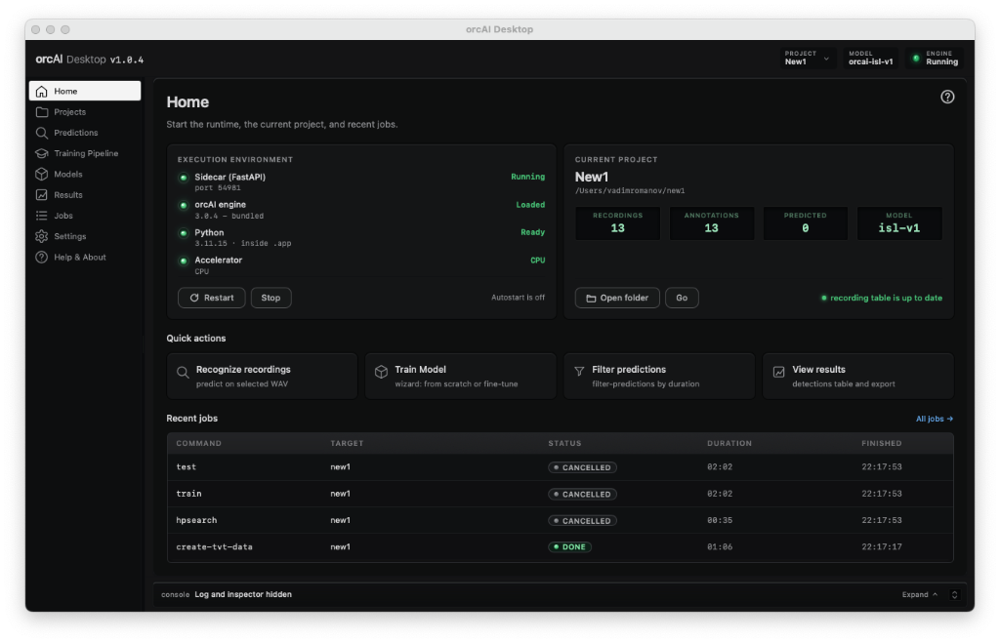

# orcAI Desktop

Desktop application for [orcAI](https://github.com/ethz-tb/orcAI), a tool for training, testing and applying AI models that detect acoustic signals in spectrograms generated from audio recordings.

> **Status:** working prototype. Based on orcAI **3.0.4**. Current Desktop release: **1.0.4**.



## Contents

- [Features](#features)
- [Download](#download)
- [Platform support](#platform-support)
- [Architecture](#architecture)
- [Repository layout](#repository-layout)
- [Development](#development)
- [Building a macOS release](#building-a-macos-release)
- [Testing](#testing)
- [Configuration](#configuration)
- [Documentation](#documentation)
- [License and attribution](#license-and-attribution)

## Features

- **Projects:** create and manage orcAI project folders, recordings, annotations, and artifacts.
- **Recognition:** apply an orcAI model to a single `.wav` file or to a batch described by a `recording_table.csv`. Files are picked through the native system dialog.
- **Analysis and filtering:** built-in spectrogram, detections table, duration / probability filters; original prediction files are kept; filtered outputs are written beside them.
- **Results:** summary KPIs and export (CSV / Audacity-compatible labels).
- **Training and testing:** full training pipeline from the Lab (prep steps, optional hpsearch, train, test), wizard, detached train monitor, and models studio (import / export / test). These functions need the local sidecar **and** the orcAI engine running (start them from **Home → Start**).
- **Self-contained release:** the macOS disk image embeds Python, TensorFlow, and the orcAI models (`orcai-isl-v1`, `orcai-nor-v1`), so no system Python or Homebrew is required.
- **Interface:** Lab layout in **English** and **Russian**. First launch defaults to English; the language can be changed in Settings and is saved.
- **Built-in help:** manual chapters from [`docs/manual`](docs/manual) are bundled into the app (**Help → Manual**).

## Download

The latest public release is **1.0.4** for macOS (Apple Silicon, arm64):  
[orcAI Desktop 1.0.4](https://github.com/macalpine1987/orcAI-Desktop/releases/tag/v1.0.4)

Open the `.dmg` and drag the app to **Applications**.

If macOS blocks the first launch (ad-hoc / unsigned build), open **System Settings → Privacy & Security** and allow the app, or use **Open** from the context menu once.

## Platform support

| Platform | Status |
|---|---|
| macOS arm64 (Apple Silicon) | Released (**1.0.4**) |
| macOS x86_64 (Intel) | Not shipped |
| Linux | In progress |
| Windows | Not planned |

## Architecture

The app has three parts:

1. **Tauri 2 shell** (`src-tauri/`) — native window, system dialogs, packaging, sidecar process lifecycle.
2. **React interface** (`apps/ui/`) — Lab UI (Vite + TypeScript + Tailwind). In development: `http://localhost:1420`.
3. **FastAPI sidecar** (`apps/sidecar/`) — local Python service that wraps orcAI **3.0.4** for recognition, training, spectrograms, and project I/O. Development and release builds use a bundled / prepared Python environment, not a random system interpreter.

The UI talks to the sidecar over HTTP on localhost. In development the sidecar picks a free port for the session. Sidecar routes: [`apps/sidecar/README.md`](apps/sidecar/README.md).

## Repository layout

```
orcai-desktop/
├── apps/
│   ├── ui/            # React Lab interface
│   └── sidecar/       # FastAPI sidecar (orcAI 3.0.4)
├── src-tauri/         # Tauri 2 shell
├── scripts/           # Icons, sidecar prep, macOS release / autonomy gate
├── docs/
│   ├── manual/        # Help chapters (RU/EN) bundled into the app
│   └── screenshots/   # README images (not bundled into the .app)
├── vendor/            # Vendored crates used by the Tauri build (e.g. bit-vec)
├── LICENSE
├── NOTICE
└── THIRD_PARTY_LICENSES
```

## Development

### Prerequisites

- **Node.js** 20+ and npm  
- **Rust** toolchain and the [Tauri 2 prerequisites](https://tauri.app/start/prerequisites/) for your OS  
- On macOS arm64 build machines: Homebrew Python 3.11 is used only to **prepare** the portable embed for release builds (end users do not need it)

### Run the full app (native window)

```bash
bash scripts/generate-icons.sh
npm install && npm install --prefix apps/ui
npm run prepare:sidecar
npm run dev
```

`npm run dev` starts the native window. The sidecar uses the Python environment prepared by `npm run prepare:sidecar`.

### Run the UI only (no native window)

```bash
cd apps/ui && npm install && npm run dev
```

Then open <http://localhost:1420>. Recognition and training will not work unless a sidecar is already running; see [Configuration](#configuration).

## Building a macOS release

```bash
npm run build:macos
```

This produces a self-contained `.app` with Python, TensorFlow, and the orcAI models embedded, then runs the **AUTONOMY GATE** checks (portable Python / no Homebrew load paths).

> `npm run build` only runs `tauri build` and does **not** embed Python. Use `build:macos` for a distributable build.

Optional disk image:

```bash
bash scripts/create-dmg.sh "/tmp/orcAI Desktop.app"
```

## Testing

```bash
npm run ui:test        # interface tests
npm run sidecar:test   # sidecar tests (Python 3.11 + orcAI)
```

## Configuration

| Variable | Purpose | Example |
|---|---|---|
| `VITE_SIDECAR_URL` | Point the UI at an already running sidecar instead of the auto-started one (UI-only / debug). | `http://127.0.0.1:8741` |

App settings (language, theme, UI scale, compute device, paths) are stored in the desktop preferences store. Project data lives in the orcAI project folder on disk (`recording_table.csv`, predictions, models, training artifacts).

## Documentation

- User manual: [`docs/manual`](docs/manual) (also inside the app under **Help**)
- Sidecar API: [`apps/sidecar/README.md`](apps/sidecar/README.md)
- Upstream tool: [orcAI](https://github.com/ethz-tb/orcAI)

## License and attribution

Licensed under [CC BY-SA 4.0](LICENSE). orcAI is developed at ETH Zurich and is also licensed under CC BY-SA 4.0. See [`NOTICE`](NOTICE) and [`THIRD_PARTY_LICENSES`](THIRD_PARTY_LICENSES) for attribution and bundled components.
